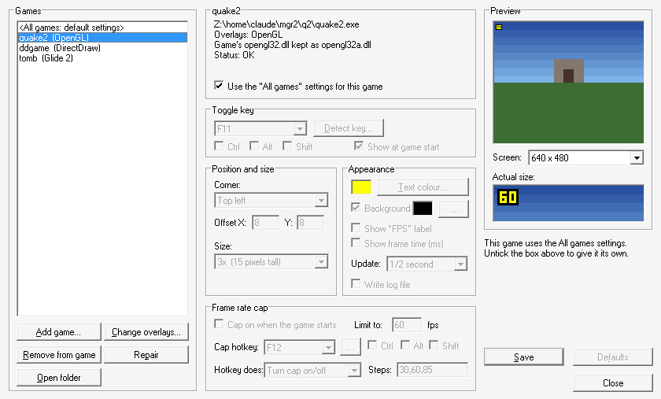

# Retrometer 9x

**An FPS counter and frame limiter for Windows 95/98/ME.** Glide, OpenGL, Direct3D 8 and DirectDraw (Direct3D 3–7), with a manager app that installs it into your games and keeps track of everything it changed.



## Features

- **On-screen FPS counter** in any corner, any size and colour, with an optional "FPS" label and frame time in ms. Toggle it with a hotkey (Ctrl/Alt/Shift combinations supported).
- **Frame rate cap** for games that run too fast, tear, or work the card harder than they need to. Toggle it, or step through a list (Off → 30 → 60 → 85) with its own hotkey. It's accurate to the frame (50 means 50.0) and uses the high-resolution timer with 1 ms sleeps.
- **Glide 2 and Glide 3**, which FRAPS never covered, as well as OpenGL (including 3dfx MiniGL), Direct3D 8 and DirectDraw.
- **Manager app (`retrometer.exe`):**
  - **Add game:** reads the game's exe and DLLs to detect which API it uses, including OpenGL loaded at run time as in Quake 2.
  - **Game-supplied drivers:** if the game ships its own driver DLL (MiniGL, a Glide wrapper), it suggests a new name and renames it on confirmation.
  - **Undo:** it records every file it touched, so **Remove** puts the game back exactly as it was.
  - **Settings:** "All games" defaults, plus per-game overrides, with a live preview.
  - **Repair:** fixes installs that a game patch or reinstall broke.
  - **Live reload:** changes reach a running game within a second.
- **Built for real 9x hardware:**
  - No C runtime and no installer.
  - Only KERNEL32/USER32/GDI32 (plus COMDLG32/SHELL32 for the manager) functions that exist on Windows 95.
  - Pentium-class code (no CMOV/SSE), so it runs on K6-2 and Pentium MMX machines too.

## Supported APIs

| Overlay | Game uses | How it hooks in |
|---|---|---|
| `opengl32.dll` | OpenGL, MiniGL | Proxy DLL; draws before `wglSwapBuffers` |
| `glide2x.dll` | Glide 2.x | Proxy DLL; writes to the back buffer (LFB) before `grBufferSwap` |
| `glide3x.dll` | Glide 3.x | Same as Glide 2 |
| `d3d8.dll` | Direct3D 8 | Proxy DLL; hooks `IDirect3DDevice8::Present` |
| `fpsdd.dll` | DirectDraw / Direct3D 3–7 | The game's `DDRAW.DLL` import is patched to `FPSDD.DLL`; hooks `Flip` and `Blt` |

**Why DirectDraw is different:** Windows 9x won't load two DLLs with the same module name, so each proxy chains to a renamed copy of the real driver. That doesn't work for `ddraw.dll`, which other parts of the system load by its exact name. So for DirectDraw the manager rewrites the game's import name instead. The new name is the same length, and a backup is kept.

## Which overlay do I need?

Install the overlay for the renderer you **play with**. One per game is normal.

| You play the game in... | Install |
|---|---|
| 3dfx / Glide mode (real Voodoo or a Glide wrapper) | Glide 2 or Glide 3 |
| OpenGL mode, or with a MiniGL (Quake engine games etc.) | OpenGL |
| A DirectX 8 game (roughly 2001 onwards) | Direct3D 8 |
| 2D DirectDraw, software rendering via DirectDraw, or the **Direct3D** mode of a 1996–2001 game (DirectX 3–7) | DirectDraw |

> **Only use the DirectDraw overlay when DirectDraw (or Direct3D 7 or older) is the game's renderer.** Most games of the era import `DDRAW.DLL` even when you play them in Glide or OpenGL, just for menus, videos, mode switching or a second renderer. Adding the DirectDraw overlay to those causes:
> - a second counter in menus;
> - wrong readings;
> - the frame cap acting on menus;
> - problems in Glide mode.
>
> The manager won't tick DirectDraw when it finds another API, and it warns you if you tick both. To undo it, use **Change overlays** and untick DirectDraw; the exe is restored.

## Quick start

1. Unzip a release into its own folder, e.g. `C:\Program Files\Retrometer`.
2. Run `retrometer.exe` and click **Add game...**.
3. Pick the game's exe. Check the detected overlays (see [Which overlay do I need?](#which-overlay-do-i-need)) and any suggested renames, then click **Install**.
4. Play. Press **F11** to show or hide the counter and **F12** for the frame cap.

Manual install and all the ini settings are covered in [`dist-README.txt`](dist-README.txt), which ships with releases as `README.txt`.

## Building

Cross-compiles on Linux with mingw-w64 (i686 gcc + windres) and Python 3:

```sh
sudo apt install gcc-mingw-w64-i686 binutils-mingw-w64-i686 python3
sh build.sh          # output in out/
```

The export forwarders for each proxy are generated from the lists in `exports/` by `gen/gen_stubs.py`. The OpenGL list comes from Wine's `opengl32.spec`, and the Glide lists come from the 3dfx Glide SDK headers (see `tools/parse_glide.py`).

### Source layout

```
common/    shared core: settings, font/layout, limiter, export resolving, vtable patching, PE import patcher
opengl/    opengl32.dll proxy
glide/     glide2x.dll / glide3x.dll proxy (one source, built twice)
d3d8/      d3d8.dll proxy
ddraw/     fpsdd.dll (DirectDraw)
config/    retrometer.exe manager (game database, detection, install/remove, UI)
patcher/   rmpatch.exe, standalone DirectDraw import patcher
gen/       export stub generator
exports/   export lists per DLL
tools/     helper for regenerating the Glide export lists
```

## Status

**Public beta: 0.1.0-beta.1.** Download it from [Releases](https://github.com/jayyanz/retrometer9x/releases). Everything has been tested under Wine:

- **Direct3D 8 and DirectDraw:** real rendering. The overlay draws, the game's render state is restored, and both page-flip and windowed blit paths work.
- **Glide:** a stand-in driver. The pixels written to the back buffer were checked.
- **OpenGL:** the draw calls and state restore were checked.
- **Frame cap:** measured accuracy and hotkeys.
- **Manager:** install, rename, patch, repair and remove, driven through the GUI.

**It has not yet been tested on real Windows 98 hardware.** Reports from real Voodoo, TNT, Rage and Rendition machines are very welcome. Please [open an issue](https://github.com/jayyanz/retrometer9x/issues/new/choose) using the bug report template, which asks for your hardware, drivers and `retrometer.log` (set `Log=1` in the game's `retrometer.ini`). Reports that it works are just as useful as bug reports.

Known limits:
- Windowed DirectDraw games that copy to the screen several times per frame over-count, and they aren't frame-capped.
- Games that load DirectDraw at run time (with LoadLibrary or COM) can't be patched.
- Direct3D 9 isn't supported yet.

## License

TBD
